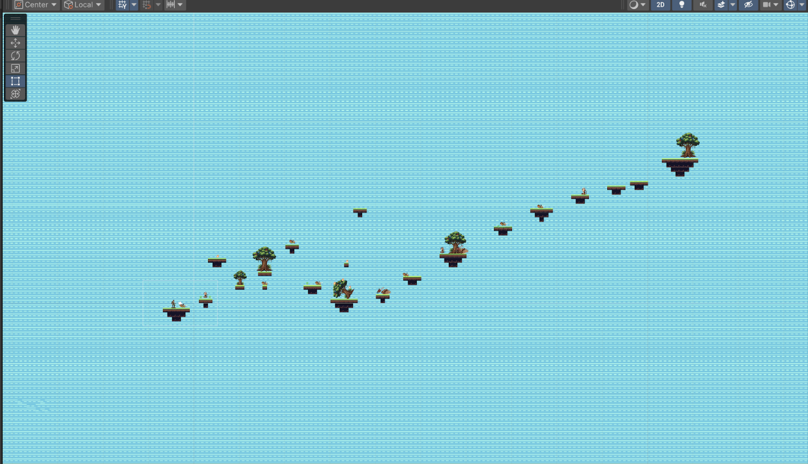

# My Portfolio

This is my portfolio website, made by Harjot Singh.

## What's in it

- `index.html`: The main page with About, Projects, Skills sections
- `styles.css`: The styles that make it look good and work on phones
- `script.js`: Code for dark mode, menu, and smooth scrolling
- `assets/avatar.svg`: My avatar picture
- `.github/workflows/pages.yml`: Auto-deploy to GitHub Pages

## My Projects

- **Holidays Animation Project** (Animation) with CodeSkulptor
  - Link: https://py3.codeskulptor.org/#user310_b3c7SYk5aM33QeL.py
  - Done: Yes
  - Notes: Snow falling and ornaments changing colors.

- **Holidays Drawing Project** (Portfolio) with CodeSkulptor
  - Link: https://py3.codeskulptor.org/#user310_MRWGb391oFt5K2k.py
  - Done: Yes
  - Notes: Built a snowman and a Christmas tree using shapes.

- **Youth Opportunities App** (App Design) with Team Intellectuals for the Infy App Challenge
  - Link: https://sadiyahtaehs.github.io/TeamIntellectuals_InfyApp26/
  - Screenshot: https://plain-enam-prod-public.komododecks.com/202611/08/vlA7Doj5PnMP5FvevoUX/image.png
  - Notes: An app concept to help teens and young adults find personalized job opportunities, build experience, and prepare for the future job market.

- **EcoLink — Environmental Mapping App** (Figma prototype)
  - Link: https://www.figma.com/proto/coH2vSBNf90LVXcZFDDLp5/EcoLink-%E2%80%94-Environmental-Mapping-App?node-id=47-39&starting-point-node-id=47%3A39
  - Screenshot: https://plain-enam-prod-public.komododecks.com/202611/08/5qVDt3rDtPyI2P5kVvEA/image.png
  - Notes: An environmental mapping app concept presented as an interactive prototype.

- **Rainforest Game** (Unity)
  - Link: https://play.unity.com/en/games/cee8c95d-8753-4f83-957c-6bb353afb3e5/rainforest-game
  - Screenshot:

    

  - Description: From creating this game, I learned how to combine entertainment with education by using gameplay to teach players about environmental issues. I also learned how to design levels with increasing difficulty, create meaningful objectives, and use features like scoring systems, obstacles, and collectibles to make the game more engaging and impactful.

This is my portfolio.